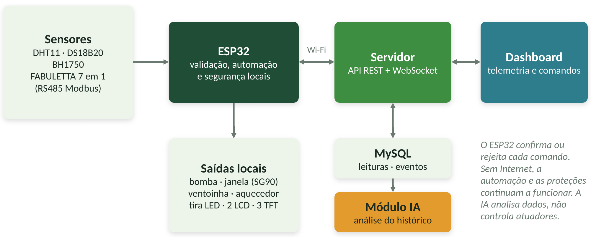
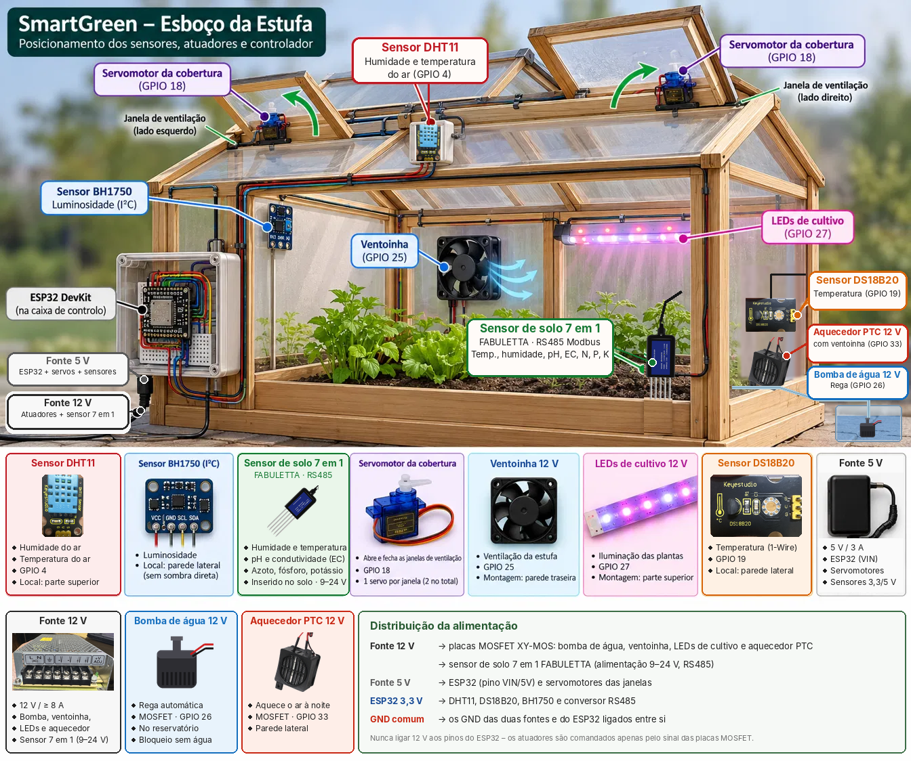
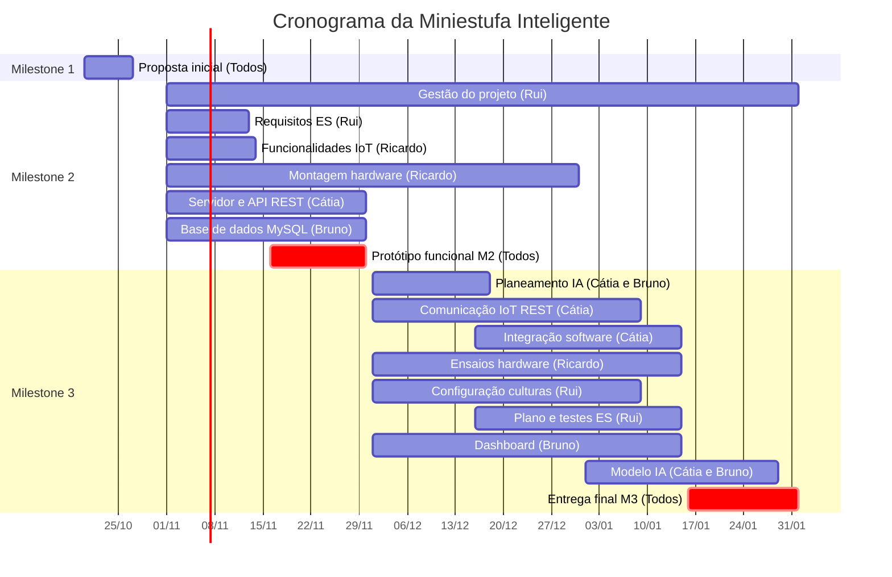

# Relatório Técnico: Smart Green
**Proposta Inicial do Projeto — Milestone 1**

| | |
|---|---|
| **Universidade** | Universidade Europeia IADE |
| **Curso** | Licenciatura em Engenharia Informática |
| **Elementos** | Cátia Macedo (20240609) · Ricardo Sanches (20241085) · Rui Francisco (20240912) · Bruno Roque (20241696) |
| **Projeto** | Miniestufa Inteligente — sistema IoT de monitorização, automação e análise de culturas |
| **Docentes** | Pedro Rosa · Alexandre Pereira · João Monge · Carla Pereira |
| **Unidades curriculares** | Sistemas Distribuídos · Computação Física e IoT · Inteligência Artificial · Engenharia de Software |
| **Palavras-chave** | ESP32, IoT, miniestufa, sensores, automação, API REST, MySQL, inteligência artificial |
| **Repositório** | https://github.com/Ruif84/PBL-5o-semestre-2026-2027 |

---

## Índice

1. [Descrição do projeto](#1-descrição-do-projeto)
2. [Público-alvo](#2-público-alvo)
3. [Guiões de teste](#3-guiões-de-teste)
4. [Enquadramento nas unidades curriculares](#4-enquadramento-nas-unidades-curriculares)
5. [Requisitos técnicos e tecnologias](#5-requisitos-técnicos-e-tecnologias)
6. [Arquitetura da solução](#6-arquitetura-da-solução)
7. [Planeamento e calendarização](#7-planeamento-e-calendarização)

---

## 1. Descrição do projeto

### Problema

Cultivar uma planta exige vigilância constante. A temperatura, a humidade do solo e a luz mudam ao longo do dia, e uma falha de rega ou de ventilação pode comprometer a cultura. Em contexto doméstico ou escolar, nem sempre há alguém disponível para acompanhar estas variações.

### Proposta

Uma miniestufa de **80 × 40 × 40 cm** (comprimento × largura × altura; 0,32 m² de base e 0,160 m³ de volume) para cultivar uma espécie de cada vez.

O utilizador escolhe a cultura e a fase de desenvolvimento num dashboard. O ESP32 lê os sensores, aplica regras locais de ventilação, rega e aquecimento e mostra os valores em displays junto à estufa. Os dados são enviados para um servidor, guardados em MySQL e apresentados em tempo real. A partir do histórico, um módulo de Inteligência Artificial analisa os dados e propõe soluções, como a correção dos níveis de azoto, fósforo e potássio (NPK).

### Objetivos

- Monitorizar o ar, o solo (sete parâmetros) e a luminosidade.
- Automatizar a ventilação, a rega e o aquecimento, mantendo o funcionamento local mesmo sem Internet.
- Mostrar os valores principais em displays junto à estufa e num dashboard em tempo real.
- Guardar o histórico numa base de dados MySQL.
- Usar Inteligência Artificial para analisar os dados e propor soluções ao utilizador.

### Motivação

Reduzir a vigilância manual e criar um protótipo onde se possam experimentar condições de cultivo com dados reais, integrando as competências das quatro unidades curriculares do semestre.

### Perfis de cultura

| Cultura | Temperatura do ar | pH do solo | 1.ª colheita |
|---|---|---|---|
| Tomate-cereja | 20–27 °C | 6,0–6,8 | 70–110 dias |
| Pimento | 22–27 °C | 6,0–6,8 | 90–150 dias |
| Alface | 15–20 °C | 6,0–7,0 | 40–75 dias |
| Espinafre | 15–20 °C | 6,0–7,0 | 35–60 dias |
| Pepino compacto | 22–28 °C | 6,0–7,0 | 50–85 dias |
| Rabanete | 15–22 °C | 6,0–7,0 | 25–45 dias |

---

## 2. Público-alvo

Estudantes, docentes, laboratórios pedagógicos e pessoas interessadas em horticultura de pequena escala que queiram acompanhar uma cultura sem estar sempre junto dela.

---

## 3. Guiões de teste

### Guião 1 — Iniciar um ciclo de alface e acompanhar a ventilação

1. A Ana, estudante responsável pela estufa do laboratório, abre o dashboard no portátil e autentica-se.
2. Seleciona a cultura **Alface** e a fase **Crescimento**. O dashboard mostra a faixa ideal de 15–20 °C.
3. Na estufa, o LCD do ar mostra 21,5 °C; o dashboard mostra o mesmo valor e a hora da leitura.
4. Como a temperatura continua acima de 20 °C, o ESP32 abre as janelas e o dashboard passa a mostrar "Janelas: abertas".
5. A Ana consulta o histórico das últimas 24 horas e vê quando e porquê as janelas abriram.

**Resultado esperado:** a Ana acompanha a cultura sem estar junto da estufa e percebe o que o sistema fez.

### Guião 2 — Receber uma recomendação sobre nutrientes

1. Uma semana depois, a Ana vê nos ecrãs TFT que o azoto está alto e abre o separador **Análise** no dashboard.
2. O dashboard assinala que o azoto está acima do valor de referência da alface.
3. A Ana pede um relatório. A IA analisa o histórico e indica uma tendência de subida nos últimos dias.
4. A IA recomenda suspender a adubação, fazer uma rega de lavagem e voltar a medir após 48 horas.
5. Dois dias depois, a Ana confirma no gráfico que o azoto está a descer.

**Resultado esperado:** o utilizador recebe uma orientação concreta e consegue verificar o efeito.

---

## 4. Enquadramento nas unidades curriculares

| Unidade curricular | Contributo para o projeto |
|---|---|
| Sistemas Distribuídos | Gestão do projeto, arquitetura de suporte (ESP32, servidor e base de dados) e integração dos componentes. |
| Computação Física e IoT | Montagem do dispositivo, programação do ESP32, sensores, atuadores e envio dos dados por REST. |
| Inteligência Artificial | Tratamento dos dados dos sensores e de uma fonte adicional (tabelas de referência de NPK por cultura) para análise e recomendações. |
| Engenharia de Software | Especificação de requisitos, modelação e plano de testes da solução. |

---

## 5. Requisitos técnicos e tecnologias

### Hardware — lista preliminar de material

| Componente | Modelo | Qtd. | Função |
|---|---|---|---|
| Microcontrolador | ESP32 DevKit V1 | 1 | Controlo local e ligação Wi-Fi |
| Sensor do ar | DHT11 | 1 | Humidade do ar |
| Sensor de temperatura | Keyestudio DS18B20 | 1 | Temperatura do ar |
| Sensor de luminosidade | BH1750 | 1 | Luminosidade ambiente |
| Sonda de solo | FABULETTA 7 em 1 (RS485 Modbus) | 1 | Temperatura, humidade, pH, EC, N, P e K do solo |
| Transceiver RS485 | MAX3485 | 1 | Comunicação com a sonda de solo |
| Expansor de saídas | MCP23017 | 1 | Comando dos atuadores |
| Displays LCD | TC1602A 16×2 com PCF8574 | 2 | Valores do ar e do solo |
| Displays TFT | GC9A01 circular 1,28" | 3 | Níveis de N, P e K |
| Conversor de níveis | Bidirecional 3,3 V ↔ 5 V | 1 | Ligação aos LCD |
| Servomotores | SG90 | até 4 | Abertura das janelas |
| Ventoinha | Ventoinha 5 V | 1 | Ventilação |
| Aquecedor | PTC ventilado 12 V / 100 W | 1 | Aquecimento |
| Iluminação | Tira LED 12 V | 1 | Demonstração de iluminação |
| Bomba de água | 12 V + depósito (**por adquirir**) | 1 | Rega |
| Alimentação | Fontes 12 V e 5 V, fusíveis e drivers | — | Energia e proteção |

Todos os componentes estão identificados, exceto a bomba de água.

### Software e tecnologias

| Camada | Tecnologia |
|---|---|
| Firmware do ESP32 | C++ com framework Arduino (Arduino IDE ou PlatformIO) |
| Servidor e API | Node.js com Express (API REST) e WebSocket |
| Base de dados | MySQL |
| Dashboard | HTML, CSS e JavaScript |
| Inteligência Artificial | Python (pandas, scikit-learn) |
| Ferramentas | GitHub, diagrams.net, EasyEDA, Wokwi e Discord |

---

## 6. Arquitetura da solução

Os sensores enviam as leituras ao ESP32, que aplica as regras locais e comanda os atuadores e os displays. Por Wi-Fi, o ESP32 comunica com o servidor, que disponibiliza uma API REST e um canal WebSocket. O servidor guarda os dados em MySQL e atualiza o dashboard. O módulo de IA trabalha sobre o histórico e não controla diretamente os atuadores.

### Esboço do artefacto físico

*Esboço da miniestufa gerado por IA.*

---

## 7. Planeamento e calendarização

### Distribuição de tarefas

| Elemento | Área principal |
|---|---:|
| Cátia Macedo | Comunicação, servidor, API REST e integração |
| Ricardo Sanches | Hardware, sensores, montagem e ensaios |
| Rui Francisco | Gestão, requisitos, configuração de culturas e testes |
| Bruno Roque | Inteligência Artificial, MySQL e dashboard |

Todas as entregas são preparadas por todos.

### Atividades

| Atividade | Responsável | Período |
|---|---|---|
| Proposta inicial (M1) | Todos | Até 27/10/2026 |
| Gestão e acompanhamento do projeto | Rui | Novembro a fevereiro |
| Especificação de requisitos (ES) | Rui | Até 13/11/2026 |
| Definição das funcionalidades IoT | Ricardo | Até 14/11/2026 |
| Montagem do hardware e circuitos | Ricardo | Novembro e dezembro |
| Servidor e API REST iniciais | Cátia | Novembro |
| Estrutura inicial da base de dados MySQL | Bruno | Novembro |
| Protótipo funcional (M2) | Todos | Até 30/11/2026 |
| Planeamento do modelo de IA | Cátia e Bruno | Até 18/12/2026 |
| Comunicação IoT e protocolo REST | Cátia | Dezembro a janeiro |
| Integração dos componentes de software | Cátia | Dezembro a janeiro |
| Integração e ensaios de sensores e atuadores | Ricardo | Dezembro a janeiro |
| Desenvolvimento do módulo de configuração de culturas | Rui | Dezembro a janeiro |
| Plano e validação de testes (ES) | Rui | Até 15/01/2027 |
| Desenvolvimento do dashboard | Bruno | Dezembro a janeiro |
| Desenvolvimento do modelo de IA | Cátia e Bruno | Até 29/01/2027 |
| Entrega final (M3) | Todos | Até 01/02/2027 |

### Gráfico de Gantt

